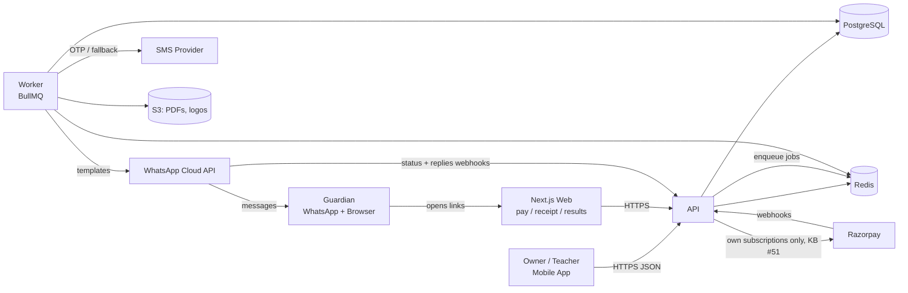
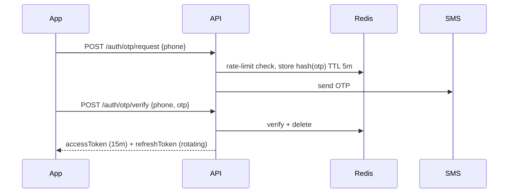
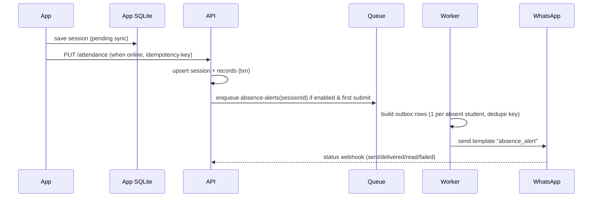
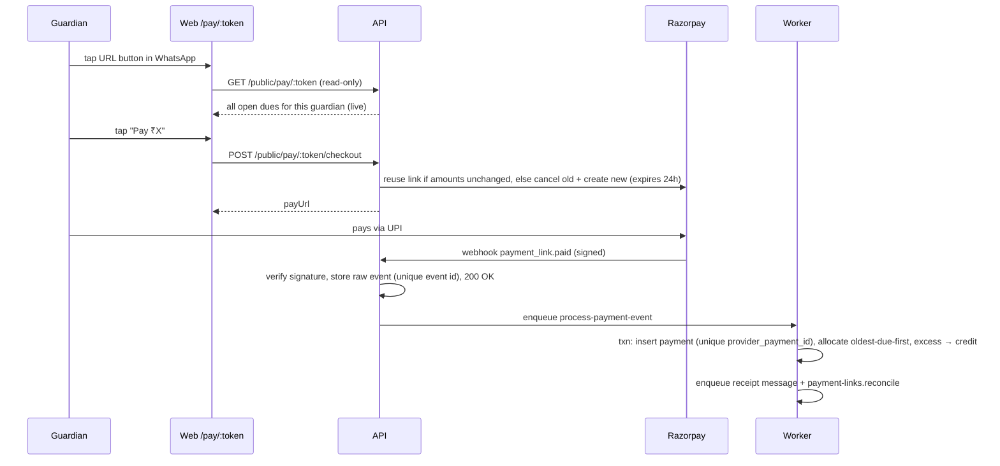

# ARCHITECTURE.md — High-Level Design (HLD)

See `LLD.md` for schema, module internals, and state machines.

## 1. Architecture style

**Modular monolith + background worker.**
- One API service (stateless, horizontally scalable).
- One worker service. Today: the outbox sender, run from the `api` package as a separate process (`src/worker.ts`) so it shares the domain modules; BullMQ arrives with scheduled jobs (KB decision #33).
- One Postgres, one Redis.
- External providers behind adapter interfaces.

Modules inside the monolith have clear boundaries (own folder, own service layer, no reaching into another module's tables directly). This keeps the option to split later without paying microservice cost now.

## 2. System context



## 3. Components

| Component | Responsibility |
|---|---|
| **Mobile app** | Owner/teacher UI. Offline cache, offline attendance queue, push notifications (v1.1). |
| **Web (Next.js)** | Guardian-facing pages via signed tokens: pay, receipt, result card. Landing page + free SEO tools. |
| **API** | Auth, CRUD for institutes/batches/students, attendance, fees, tests, notices, subscription, webhooks intake. Enforces tenancy + entitlements. |
| **Worker** | Scheduled jobs (invoice generation, reminder planning), message sending, webhook processing, PDF generation, usage counters. |
| **PostgreSQL** | Source of truth. |
| **Redis** | BullMQ queues, rate limits, OTP throttling, idempotency cache, short-lived caches. Must run with `maxmemory-policy noeviction` (BullMQ requirement) and persistence (AOF) enabled. |
| **Providers** | WhatsApp, SMS, Payments, Storage — each behind an interface with a fake implementation for tests/local. |

## 4. API modules

```
auth · users · institutes · members · batches · students · enrollments
attendance · fees (invoices, payments, payment-links) · reminders
messaging (outbox, templates, opt-ins) · tests · notices
subscriptions (plans, entitlements, usage) · ~~payouts~~ (not in the MVP, KB #51)
data-rights (export, deletion, erasure) · webhooks (WhatsApp, subscription billing) · admin
```

## 5. Key flows

### 5.1 Login (phone OTP)



OTP is the **only** message the API sends directly (not via the outbox): the user is waiting on the screen, and a queued OTP would add latency for no benefit. Everything else goes through `message_outbox`.

### 5.2 Attendance with absence alerts (offline-capable)



### 5.3 Invoice generation and reminders

1. **Daily 06:00 IST** scheduler: for each active institute whose current period (latest billing day ≤ today) has no completed `invoice_runs` row → enqueue `invoices.generate(instituteId, period)`. This catches up automatically if a day was missed.
2. Worker creates invoices for active enrollments (idempotent by unique `(enrollment_id, period_start)`); `one_time` fees are billed at enrollment, not here; ₹0 invoices are never created.
3. **Every 15 minutes** scheduler: `reminders.plan` finds guardians with an unpaid invoice whose reminder offset falls today; creates one outbox row per guardian with `scheduled_for` respecting quiet hours and the 1-per-day rule. Content is **not** frozen at this point.
4. `messages.send` worker picks due outbox rows, checks opt-in, **re-validates against current data** (skips if everything was paid meanwhile, recomputes totals otherwise), checks plan quota, mints the guardian link token, and sends via provider.

### 5.4 Online payment

> **Not in the MVP (KB #51).** Parents pay the institute directly (cash, its own UPI ID) and the owner records it; receipts go out as WhatsApp text. No pay page, payment links or Razorpay for parents. This flow is kept for a possible later opt-in.



Rules:
- **Webhook handlers only verify, persist, and enqueue** — never do business logic inline. Processing is idempotent so redelivery is safe.
- **One pay page per guardian**, not per invoice, so sibling dues are paid together and the page never shows a stale amount.
- **GET never has side effects** on public pages (WhatsApp and browsers prefetch links). Payment links are created only on the explicit checkout POST.
- **Any change to an invoice's remaining amount** (offline payment, void, waive, cancel) enqueues `payment-links.reconcile`, which cancels provider links whose amount no longer matches.

### 5.5 Subscription

- Entitlements resolved per request from `subscriptions` + `plans` config (cached in Redis, 60 s).
- Payment confirmation (store or Razorpay webhook) → update subscription → bust entitlement cache.
- Nightly job: move expired subscriptions to `past_due` → after grace → `free`.

## 6. Multi-tenancy

- Tenant = **institute**. Every tenant-owned table has `institute_id`.
- API routes are scoped: `/v1/institutes/:instituteId/...`. Middleware checks membership + role, then injects `ctx.instituteId`.
- Repository functions **require** `instituteId` as a parameter (enforced by types).
- Defense in depth (v1.1): Postgres Row-Level Security using `SET app.institute_id` per transaction.
- Cross-tenant access tests in CI.

## 7. Offline strategy (mobile)

- Reads: TanStack Query persisted cache → app usable offline with last-known data.
- Writes allowed offline: **attendance only** (MVP). Stored in SQLite outbox with client-generated UUID + idempotency key; synced FIFO when online.
- All other writes require network (clear "you're offline" UI).
- Server is source of truth; client reconciles after sync.

## 8. Reliability patterns

| Pattern | Where |
|---|---|
| Transactional outbox | Messages are DB rows first, sent by worker |
| Idempotency keys | Mutating API calls from mobile (`Idempotency-Key` header), provider calls, webhook events |
| Retries w/ exponential backoff + DLQ | All BullMQ jobs |
| Unique constraints as guards | invoices per period, payments per provider id, webhook event ids |
| Circuit breaker / provider fallback | WhatsApp → SMS (v1.1) |
| Graceful degradation | If messaging is down, fees/attendance still work; outbox catches up |

## 9. Security

- TLS only; HSTS on web.
- JWT access tokens (15 min) signed with rotating keys; refresh tokens random 256-bit, stored hashed, rotated on use, reuse detection revokes family.
- Guardian links use random tokens (≥ 128-bit) stored hashed with expiry — not JWTs in URLs. Tokens are minted by the send worker at send time; the raw token exists only in the outgoing provider request, never in the outbox, DB, or logs. Links are sent as WhatsApp URL buttons with a dynamic suffix, not inline URLs.
- Webhook signature verification (Razorpay HMAC, Meta `X-Hub-Signature-256`).
- Rate limits: OTP per phone/IP plus a global daily OTP budget, API per user, public pages per IP. OTP only to +91 mobile numbers (SMS-pumping protection).
- Secrets in AWS Secrets Manager / SSM; never in repo.
- PII minimization: only names + guardian phone required. No student DOB/address in MVP.
- Audit log for money and permission changes.
- Data residency: India region.

## 10. Scalability path

| Stage | Institutes | Setup |
|---|---|---|
| MVP | ≤ 500 | One EC2 instance (api + worker containers, Caddy for TLS), small RDS Postgres, small ElastiCache Redis — all ap-south-1. No load balancer or NAT gateway |
| Growth | ≤ 5,000 | Move api/worker to ECS Fargate: 2–4 API tasks (autoscale) behind an ALB, separate worker pools per queue (messages vs. jobs), RDS read replica for dashboards |
| Scale | ≤ 20,000+ | Partition `message_outbox` & `attendance_records` by month, dedicated Redis for queues, consider splitting messaging service |

Hot paths to watch: attendance writes at peak class hours (16:00–20:00 IST), reminder bursts on billing days (spread with jitter across the day), WhatsApp throughput tier limits.

## 11. Observability

- Request logs with `requestId`, `userId`, `instituteId` (never OTPs, tokens, or full phone numbers — mask middle digits).
- Metrics: queue depth/latency, messages by status, webhook lag, payment success rate, p95 latency.
- Alerts: webhook processing failures, DLQ growth, queue latency > 10 min, error rate spike, DB CPU > 80%.

## 12. Deployment

- GitHub Actions: lint → typecheck → test → build images → migrate (staging) → deploy staging → manual promote to prod.
- DB migrations: forward-only, backward-compatible (expand → migrate → contract).
- Mobile: EAS Build for store releases; EAS Update for JS-only fixes (with runtime version policy).

## 13. Shared WhatsApp sender number

MVP sends every institute's messages from **one platform WhatsApp Business number**. This is the simplest to launch (one Meta business verification, one set of approved templates), but it shapes several parts of the system:

| Consequence | How we handle it (details: LLD §6.8) |
|---|---|
| Guardians see our brand as the sender, not the institute | Every template starts with or names `{{institute}}`; display name and profile explain "updates on behalf of your tuition center" |
| Parents reply to our number ("will pay tomorrow") | Stored in `inbound_messages`, routed to the institute of the latest message to that phone, shown in the owner's "Parent replies"; one auto-reply per 24 h pointing to the institute's phone |
| `STOP` doesn't say which institute | Opt-out is global across institutes; receipts still sent; `START` resumes |
| One spammy institute lowers the number's quality rating and messaging limits for **everyone** | Per-institute quality guard (auto-pause on high STOP/block rate), daily caps for new/trial institutes, strict notice limits, priority sending (receipts/absence first) when near Meta's daily recipient limit |
| Meta's unique-recipient limit per 24 h caps total volume | Tracked in Redis; alert at 80%; grow the tier by keeping quality high. At Growth stage, consider a second number or per-institute numbers for large Academy customers (via a BSP / embedded signup) |
