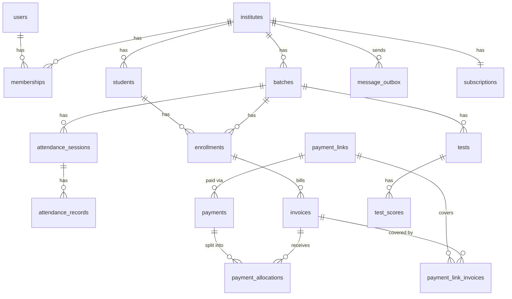
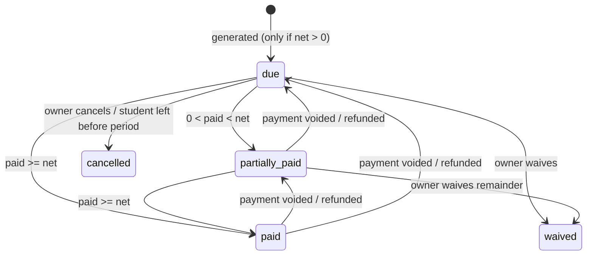

# LLD.md — Low-Level Design

## 1. Conventions

- IDs: UUID v7 (time-ordered) generated in app code.
- Money: integer **paise**. Postgres column type `bigint` (sums can't overflow); in TypeScript a plain `number` that must be a safe integer — Drizzle `bigint(..., { mode: 'number' })`, Zod `zMoneyPaise = z.number().int().min(0).max(Number.MAX_SAFE_INTEGER)`. Not JS `BigInt`: it can't be JSON-serialised and complicates Zod, React Native, and the API. Never floats; all arithmetic through helpers in `packages/shared/src/money.ts` (add/subtract/multiply-by-integer, percentages with explicit rounding, `assertSafePaise` on every value read from SQL aggregates).
- Time: `timestamptz` in UTC. Business dates (attendance date, due date, period) are `date` interpreted in the institute's timezone (default `Asia/Kolkata`).
- Phones: E.164 `text` (`+919876543210`), validated by shared Zod schema.
- Soft delete via `archived_at` / status — never hard-delete money or attendance rows.
- All tenant tables: `institute_id uuid not null` + index starting with `institute_id`.
- `created_at`, `updated_at` on every table.

## 2. Database schema



### 2.1 Tables (DDL sketch — Drizzle schema is the source of truth)

```sql
-- identity
users (
  id uuid pk, phone text unique not null, name text,
  locale text not null default 'en',            -- en | hi
  created_at, updated_at
)

refresh_tokens (
  id uuid pk, user_id uuid fk, token_hash text unique not null,
  family_id uuid not null, expires_at timestamptz, revoked_at timestamptz,
  replaced_by uuid, device_info jsonb, created_at
)

institutes (
  id uuid pk, name text not null,
  type text not null check (type in ('tuition','academy','home_tutor')),
  city text, logo_url text,
  timezone text not null default 'Asia/Kolkata',
  billing_day smallint not null default 1 check (billing_day between 1 and 28),
  due_after_days smallint not null default 6,
  settings jsonb not null default '{}',   -- absenceAlerts, reminderOffsets, quietHours...
  payout_account_id text,                 -- provider linked account id
  payout_status text not null default 'not_started'
    check (payout_status in ('not_started','pending','active','rejected')),
  upi_vpa text,                           -- institute's own UPI ID; used on the pay page until payouts are active
  messaging_paused_at timestamptz,        -- set by quality guard (§6.8); blocks automatic messages
  deletion_requested_at timestamptz,      -- institute deletion: purge after 30 days (§6.9)
  purged_at timestamptz,                  -- set by the purge (with archived_at): the row is a tombstone
  created_by uuid fk users, created_at, updated_at, archived_at
)

memberships (
  institute_id uuid fk, user_id uuid fk,
  role text check (role in ('owner','teacher','staff')),
  batch_scope uuid[] null,                -- null = all batches (v2 per-batch access)
  created_at,
  primary key (institute_id, user_id)
)

-- academic
batches (
  id uuid pk, institute_id uuid fk, name text not null, subject text,
  schedule jsonb not null,                -- {days:[1,3,5], start:"16:00", end:"17:00"}
  default_fee_paise bigint not null default 0,
  default_fee_cycle text not null check (default_fee_cycle in ('monthly','quarterly','half_yearly','yearly','one_time','none')),
                                          -- copied to enrollments; the enrollment's value is what bills
  archived_at, created_at, updated_at
)
index (institute_id) where archived_at is null

students (
  id uuid pk, institute_id uuid fk, name text not null,
  guardian_name text, guardian_phone text,          -- required unless erased (check below)
  student_phone text,                     -- the student's own mobile, optional; own consent; cleared on erasure
  status text not null default 'active' check (status in ('active','left')),
  joined_on date not null, left_on date, notes text,
  roll_number text,                       -- optional ("12", "12A"); cleared on erasure
  erased_at timestamptz,                  -- PII erased on request (§6.9): name → "Erased student",
                                          -- guardian name/phone and notes cleared; amounts kept
  created_at, updated_at,
  check (erased_at is not null or guardian_phone is not null)
)
index (institute_id, status), index (institute_id, guardian_phone),
index (institute_id, (lower(name) collate "C"), id)   -- name-sorted keyset paging; "C" = same order as JS
unique (institute_id, lower(roll_number)) where status = 'active' and roll_number is not null

enrollments (
  id uuid pk, institute_id uuid fk, student_id uuid fk, batch_id uuid fk,
  fee_paise bigint not null,              -- copied from batch, overridable
  discount_paise bigint not null default 0,
  fee_cycle text not null check (fee_cycle in ('monthly','quarterly','half_yearly','yearly','one_time','none')),
                                          -- copied from batch.default_fee_cycle, overridable
                                          -- (e.g. a student paying quarterly in a monthly batch)
  cycle_anchor date,                      -- UNUSED: the anchor is derived from invoices (KB #35). Was: period_start of the first billed cycle; multi-month
                                          -- cycles (quarterly 3, half_yearly 6, yearly 12 months)
                                          -- repeat from here. null until first bill
  start_date date not null, end_date date,   -- both inclusive; end_date null = still enrolled
  created_at, updated_at,
  unique (student_id, batch_id, start_date),
  check (discount_paise between 0 and fee_paise), check (end_date is null or end_date >= start_date),
  foreign key (institute_id, student_id) references students (institute_id, id),   -- same institute,
  foreign key (institute_id, batch_id) references batches (institute_id, id)       -- enforced by the DB
)
unique index (student_id, batch_id) where end_date is null   -- one OPEN enrollment per student+batch
index (institute_id, batch_id), index (institute_id, student_id)
-- students and batches each carry unique (institute_id, id) as the target of those foreign keys

attendance_sessions (
  id uuid pk, institute_id uuid fk, batch_id uuid, date date not null,
  taken_by uuid fk users on delete set null,   -- first phone's user; deleting the account keeps the session
  submitted_at timestamptz not null,           -- SERVER time of the last sync
  alerts_enqueued_at timestamptz,         -- guards "alert only once"
  client_id uuid not null unique,         -- first phone's offline id: retries find the same row
  created_at, updated_at,
  unique (batch_id, date), unique (institute_id, id),
  foreign key (institute_id, batch_id) references batches (institute_id, id)
)
index (institute_id, date)

attendance_records (
  session_id uuid, student_id uuid, institute_id uuid,
  status text check (status in ('present','absent','late','leave')),
  updated_by uuid fk users on delete set null, updated_at timestamptz not null,   -- server time
  primary key (session_id, student_id),
  foreign key (institute_id, session_id) references attendance_sessions (institute_id, id) on delete cascade,
  foreign key (institute_id, student_id) references students (institute_id, id)
)
index (institute_id, student_id)

tests (
  id uuid pk, institute_id uuid fk, batch_id uuid not null,
  name text not null, date date not null,
  max_marks numeric(6,2) not null check (max_marks > 0),   -- app: <= 1000, at most 2 decimals
  created_by uuid null fk users on delete set null,
  results_sent_at timestamptz null,       -- first "Send results"
  created_at, updated_at,
  unique (institute_id, id),
  foreign key (institute_id, batch_id) references batches (institute_id, id)
)
index (institute_id, batch_id, date)

test_scores (
  test_id, student_id, institute_id,
  marks numeric(6,2) null, is_absent bool not null default false,
  updated_by uuid null fk users on delete set null, updated_at,
  primary key (test_id, student_id),
  check ((is_absent and marks is null) or (not is_absent and marks is not null and marks >= 0)),
  foreign key (institute_id, test_id) references tests (institute_id, id) on delete cascade,
  foreign key (institute_id, student_id) references students (institute_id, id)
)
index (institute_id, student_id)
-- marks <= max_marks spans two tables: saving scores and changing max_marks both lock the
-- tests row (SELECT ... FOR UPDATE) and check under the lock (TestRepository).
-- Read as JS numbers (drizzle numeric mode 'number'): at most 2 decimals, so exact enough.

-- fees
invoice_counters (
  institute_id uuid pk fk, next_value bigint not null default 1   -- per-institute invoice numbers
)

invoice_runs (                            -- one row per institute per billing period; enables catch-up
  institute_id uuid fk, period_start date not null,
  started_at timestamptz, completed_at timestamptz,
  primary key (institute_id, period_start)
)

invoices (
  id uuid pk, institute_id uuid fk, student_id uuid fk,
  enrollment_id uuid fk null,             -- null for manual invoices
  kind text not null check (kind in ('cycle','one_time','manual')),
  number text not null,                   -- per-institute sequence, e.g. INV-000123
  batch_id uuid null,                     -- snapshot (null for manual): ?batchId filter, reports
  description text not null,              -- snapshot, e.g. "Class 9 Science · Oct 2026"; pay page + receipt
  period_start date null, period_end date null,   -- null for manual
  amount_paise bigint not null check (amount_paise > 0),
  discount_paise bigint not null default 0
    check (discount_paise >= 0 and discount_paise < amount_paise),  -- net is always > 0
  paid_paise bigint not null default 0,   -- cache of sum(active allocations); recomputed in the same txn
  due_date date not null,
  status text not null check (status in ('due','partially_paid','paid','waived','cancelled')),
  close_reason text,                      -- why waived or cancelled
  created_at, updated_at,
  unique (institute_id, number),
  check ((kind = 'manual') = (enrollment_id is null))
)
unique index (enrollment_id, period_start) where kind in ('cycle','one_time')
index (institute_id, status, due_date)
index (institute_id, student_id)

payments (                                -- money received; one row per provider payment or offline entry
  id uuid pk, institute_id uuid fk,
  guardian_phone text not null,
  amount_paise bigint not null check (amount_paise > 0),
  method text check (method in ('upi_link','cash','bank','other')),
  provider text, provider_payment_id text unique,  -- null for offline
  payment_link_id uuid fk null,           -- FK added with payment_links
  idempotency_key text,                   -- unique (institute_id, idempotency_key): AGENTS rule 6
  receipt_number text,                    -- RCT-000001, unique (institute_id, receipt_number); null before Step 24
  status text not null default 'active' check (status in ('active','voided','refunded')),
  voided_at timestamptz, voided_by uuid, void_reason text,
  recorded_by uuid null, note text,
  paid_at timestamptz not null, created_at, updated_at
)

receipt_counters (institute_id pk fk, next_value bigint)   -- like invoice_counters; taken in the payment's transaction

payment_allocations (                     -- how a payment is split across invoices
  payment_id uuid fk, invoice_id uuid fk, institute_id uuid not null,
  amount_paise bigint not null check (amount_paise > 0),
  primary key (payment_id, invoice_id)
)
index (institute_id, invoice_id)
-- payment.amount - sum(allocations) = unallocated guardian credit (applied manually in MVP)

payment_links (                           -- provider link for one guardian's open dues at one moment
  id uuid pk, institute_id uuid fk, guardian_phone text not null,
  provider text, provider_link_id text unique, short_url text,
  amount_paise bigint not null,
  fingerprint text not null,              -- hash of sorted (invoice_id, remaining_paise) it was created for
  status text not null check (status in ('active','paid','cancelled','expired')),
  expires_at timestamptz not null, created_at, updated_at
)
index (institute_id, guardian_phone, status)

payment_link_invoices (                   -- what the link was meant to cover (snapshot)
  payment_link_id uuid fk, invoice_id uuid fk, institute_id uuid not null,
  amount_paise bigint not null,
  primary key (payment_link_id, invoice_id)
)
index (invoice_id)

webhook_events (
  id uuid pk, provider text, event_id text, event_type text,
  payload jsonb, signature_valid bool, received_at, processed_at, error text,
  unique (provider, event_id)
)

-- messaging
guardian_contacts (
  institute_id, phone text, opt_in_status text check (opt_in_status in ('unknown','opted_in','opted_out')),
  opt_in_source text,                     -- add_student | verbal | form | whatsapp
  updated_at,
  primary key (institute_id, phone)
)

message_outbox (
  id uuid pk, institute_id uuid fk,
  to_phone text not null, channel text check (channel in ('whatsapp','sms')),
  template text not null, params jsonb not null, locale text,
  category text check (category in ('fee_reminder','receipt','absence','result','notice','otp')),
  status text not null default 'queued'
    check (status in ('queued','scheduled','sending','sent','delivered','read','failed','skipped')),
  scheduled_for timestamptz not null, attempts int default 0,
  provider_message_id text unique, error_code text, error_message text,
  skip_reason text,                       -- opted_out | no_consent | over_quota | plan_disallows | nothing_due
                                          -- | stale | expired | institute_paused | platform_limit
  priority smallint not null,             -- 1 receipt · 2 absence · 3 fee_reminder/result · 4 notice
  expires_at timestamptz null,            -- don't send after this (e.g. absence alert next morning 10:00)
  dedupe_key text unique not null,        -- e.g. fee_reminder:{instituteId}:{phone}:{date}
  related_type text, related_id uuid,
  created_at, updated_at
)
index (status, priority, scheduled_for)

whatsapp_opt_outs (                       -- GLOBAL, not per tenant: all institutes share one sender number
  phone text pk, opted_out_at timestamptz not null, source text   -- 'stop_reply' | 'support'
)

inbound_messages (                        -- replies guardians send to our WhatsApp number
  id uuid pk, provider_message_id text unique, from_phone text not null,
  institute_id uuid null,                 -- resolved: institute of the latest outbound message to this phone
  kind text check (kind in ('stop','start','text','media','other')),
  body text, received_at timestamptz not null, handled_at timestamptz
)
index (institute_id, received_at)
-- params never contain raw public tokens. Links are stored as placeholders,
-- e.g. {"payToken": {"$mint": "pay"}}, and minted by the send worker (§6.3).

-- public links
public_tokens (
  token_hash text pk, institute_id uuid not null,
  kind text check (kind in ('pay','receipt','result')),
  guardian_phone text null,               -- kind=pay: covers ALL open dues of this guardian at this institute
  ref_id uuid null,                       -- receipt: payment id · result: test id
  student_id uuid null,                   -- result: which student's card
  message_id uuid null,                   -- outbox row that minted it
  expires_at timestamptz not null, created_at
)

-- billing
subscriptions (
  institute_id uuid pk fk, plan text check (plan in ('free','starter','pro','academy')),
  status text check (status in ('trialing','active','past_due','cancelled','free')),
  interval text check (interval in ('month','year')),
  provider text, provider_sub_id text,
  current_period_end timestamptz, grace_until timestamptz, updated_at
)

message_usage (institute_id, day date, sent int, primary key (institute_id, day))
                                          -- automatic messages SENT per institute-local day. Month and trial
                                          -- totals are sums; checks + increment run under a per-institute
                                          -- advisory lock (KB #39). Notice counts: added with notices.

data_exports (
  id uuid pk, institute_id uuid fk, requested_by uuid fk users on delete set null,
  status text check (status in ('queued','running','ready','failed','expired')),
  file_key text,                          -- in the FileStore (local folder in dev, S3 later); never public
  byte_size int, attempts int, error text, -- error: a code only, never data
  started_at, ready_at, expires_at timestamptz, created_at, updated_at
)
unique index (institute_id) where status in ('queued','running')   -- one in progress per institute
index (status, created_at)                -- the worker's claim (FOR UPDATE SKIP LOCKED)

notices (id uuid pk, institute_id fk, kind text check (kind in ('general','holiday','schedule_change')), batch_ids uuid[],
         content jsonb,                  -- the template params guardians read
         sent_by uuid fk users on delete set null, recipients int, day date, created_at)
index (institute_id, day)               -- daily limit: count + insert under a per-institute advisory lock

audit_log (
  id uuid pk,                             -- UUIDv7: time-ordered, so the log pages by id
  institute_id uuid fk, actor_user_id uuid fk users on delete set null, action text, entity_type text,
  entity_id uuid, before jsonb, after jsonb, created_at   -- statuses/amounts/ids only, NO personal data
)
index (institute_id, id)
```

## 3. State machines

### 3.1 Invoice



Rules:
- `net = amount - discount` (always > 0; ₹0 invoices are never created — see §6.1).
- `paid = sum(payment_allocations.amount)` over payments with `status = 'active'`. `invoices.paid_paise` is a cache of this.
- `remaining = net - paid`. `status = recompute(net, paid)` → `due` (paid = 0) · `partially_paid` · `paid` (paid ≥ net).
- `waived` / `cancelled` are terminal: voiding a payment allocated to one removes the allocation (audited) but does not reopen it.
- Any change to an invoice's `paid`, status, or amount happens in one DB transaction with `SELECT ... FOR UPDATE` on the invoice(s), and enqueues `payment-links.reconcile` (§6.6) after commit.
- Overpayment / late payment: the part of a payment that can't be allocated stays unallocated = guardian credit (shown on the student; v2 applies it to the next invoice).

### 3.2 Message

```
queued → scheduled (quiet hours) → sending → sent → delivered → read
                                          ↘ failed (retry ≤ 3 → DLQ)
queued → skipped (opted out / over quota / plan disallows)
```
Provider status webhooks only move forward (ignore regressions, e.g. `delivered` after `read`).

### 3.3 Subscription

```
trialing → active (paid) | free (trial ended, unpaid)
active → past_due (renewal failed) → active (paid) | free (grace ended)
active → cancelled (at period end) → free
```

## 4. API module structure (apps/api)

```
src/
├── app.ts                 # fastify instance, plugins
├── plugins/               # auth, tenancy, idempotency, rate-limit, error-handler, zod
├── modules/
│   └── fees/
│       ├── fees.routes.ts       # HTTP only: parse, call service, map response
│       ├── fees.service.ts      # business logic, transactions
│       ├── fees.repo.ts         # Drizzle queries (instituteId required)
│       ├── fees.schemas.ts      # re-exports from packages/shared
│       ├── fees.events.ts       # job enqueue helpers
│       └── fees.test.ts
└── lib/                   # db, redis, queue, logger, clock, ids
```

Layer rules:
- routes → service → repo. Routes never touch the DB.
- Services get dependencies via **constructor injection of interfaces**, wired in `apps/api/src/container.ts` (composition root) → easy fakes in tests.
- A module may call another module's **service**, never its repo.
- `Clock` is injected (no `new Date()` in services) → time-based logic is testable.

### 4.1 OOP + SOLID in this codebase

| Principle | How it shows up here |
|---|---|
| **S** — Single responsibility | `FeesController` only maps HTTP ↔ service; `FeesService` holds the use-case logic; `DrizzleInvoiceRepository` only talks SQL; `Invoice` holds invoice rules (status recompute, allocation) |
| **O** — Open/closed | New message category = new `MessageRevalidator` class registered in a map; the send worker doesn't change. New payment provider = new `PaymentProvider` implementation |
| **L** — Liskov substitution | `FakeWhatsAppProvider` and `MetaWhatsAppProvider` both satisfy `MessagingProvider` and pass the same contract test suite |
| **I** — Interface segregation | `Clock`, `IdGenerator`, `InvoiceReader` / `InvoiceWriter` instead of one giant `Deps` or `Repository` interface |
| **D** — Dependency inversion | `FeesService` depends on `InvoiceRepository` (interface in the module), never on Drizzle; `container.ts` decides which implementation |

File layout per module (extends the list above):
```
modules/fees/
├── domain/              # Invoice entity, Allocation logic — no I/O, no framework imports
├── fees.controller.ts   # class FeesController (registered by fees.routes.ts)
├── fees.service.ts      # class FeesService(deps via constructor)
├── fees.repository.ts   # interface InvoiceRepository
├── drizzle-invoice.repository.ts
└── fees.test.ts
packages/shared/src/
├── money.ts             # class Money (value object)
├── phone-number.ts      # class PhoneNumber
├── local-date.ts        # class LocalDate
└── clock.ts             # interface Clock + SystemClock + FixedClock (tests)
```
### 4.2 Real vs fake implementations

| Interface | Production / staging | Tests & local dev |
|---|---|---|
| `Clock` | `SystemClock` | `FixedClock` |
| `RateLimiter` | `RedisRateLimiter` (atomic `INCR` + `EXPIRE`) | `InMemoryRateLimiter` |
| `OtpStore` | `RedisOtpStore` (hash + TTL, `HINCRBY` for attempts) | `InMemoryOtpStore` |
| `SmsProvider` | `Msg91SmsProvider` (DLT template) | `FakeSmsProvider` |
| `OtpCodeGenerator` | `RandomOtpCodeGenerator` (`crypto.randomInt`) | `FixedOtpCodeGenerator` |

- Selection happens only in `container.ts`, by environment. Services never know which one they got.
- Production startup fails if a fake is wired in (AGENTS.md → Testing).
- A contract test suite per interface runs against both columns.
- OTP and rate limiting **fail closed**: if Redis is unreachable, OTP requests are refused, never allowed through unlimited.

Value objects serialise to plain JSON at the API boundary (`Money` → `amountPaise: number`); Zod schemas validate the plain shape and controllers convert to/from value objects.

## 5. Key interfaces

```ts
// packages/providers
export interface MessagingProvider {
  sendTemplate(input: {
    to: string; template: string; locale: 'en' | 'hi';
    params: Record<string, string>; idempotencyKey: string;
  }): Promise<{ providerMessageId: string }>;
  parseStatusWebhook(req: RawRequest): StatusEvent[];   // throws on bad signature
}

export interface PaymentProvider {
  createPaymentLink(input: {
    referenceId: string;                 // payment_links.id
    amountPaise: number; description: string;   // safe integer paise (§1)
    customerPhone: string; payoutAccountId: string;
    expiresAt: Date;                     // always set; links are short-lived (§6.6)
    idempotencyKey: string;
  }): Promise<{ linkId: string; shortUrl: string }>;
  cancelPaymentLink(linkId: string): Promise<void>;   // no-op if already paid/cancelled/expired
  verifyWebhook(rawBody: Buffer, signature: string): boolean;
  parseWebhook(payload: unknown): PaymentEvent;
}

export interface SmsProvider { sendOtp(to: PhoneNumber, code: string): Promise<void> }

// apps/api
export interface Entitlements {
  plan: Plan; maxStudents: number | null; maxMembers: number | null;   // null = unlimited
  monthlyMessages: number; features: Set<FeatureKey>;
}
export interface EntitlementsService {
  get(instituteId: string): Promise<Entitlements>;          // plan from subscriptions (dates decide); cached 30 s per process (CachedPlanLookup)
  limitFor(instituteId: string, limit: 'activeStudents' | 'members'): Promise<number | null>;
  assertFeature(instituteId: string, feature: FeatureKey): Promise<void>;   // 402 FEATURE_NOT_IN_PLAN
}
// Limits are ENFORCED by the repository that inserts, atomically: e.g.
// StudentRepository.createWithinLimit(instituteId, students, max) counts + inserts under
// SELECT … FOR UPDATE on the institute row; the service turns 'limit_reached' into 402.
export interface Clock { now(): Date }
```

Each provider has `Fake*` implementations used in local dev and tests (records calls, simulates webhooks).

## 6. Core algorithms

### 6.1 Invoice generation (idempotent, self-healing)

Periods: a monthly period starts on the institute's `billing_day` and ends the day before the next one. `due_date = period_start + due_after_days`.

**Billing job (worker, every 15 min — `BillingScheduler` → `InvoiceGenerator.runDue`)** — catches up after outages instead of relying on "billing day is today":
```
for institute in activeInstitutes():
  today = institute local date
  period = currentPeriodStart(institute.billing_day, today)   // latest billing day <= today
  if invoice_runs(institute, period).completed_at is set: continue
  INSERT INTO invoice_runs (institute_id, period_start, started_at)
    ON CONFLICT DO NOTHING
  enqueue invoices.generate(instituteId, period)               // jobId = instituteId:period
```

**Job `invoices.generate(instituteId, period)`**:
```
for enrollment in activeEnrollments(instituteId, period):   // student active, start_date <= period_end,
                                                             // end_date null or >= period_start
  if enrollment.fee_cycle in ('none','one_time'): continue   // one_time is billed at enrollment only
  months = cycleMonths(enrollment.fee_cycle)                // monthly 1, quarterly 3, half_yearly 6, yearly 12
  anchor = period_start of the enrollment's FIRST cycle invoice (derived; KB #35)
  if months > 1 and anchor is not null
     and monthsBetween(anchor, period) % months != 0: continue
  if student left or batch archived: continue
  net = enrollment.fee_paise - enrollment.discount_paise
  if net <= 0: continue                                      // never create ₹0 invoices
  BEGIN
    number = UPDATE invoice_counters SET next_value = next_value + 1
             WHERE institute_id = ? RETURNING next_value - 1
    INSERT INTO invoices (kind='cycle', period_start, period_end = period_start + cycle length - 1, ...)
    ON CONFLICT (enrollment_id, period_start) WHERE kind IN ('cycle','one_time') DO NOTHING
    if nothing inserted: ROLLBACK      // don't burn an invoice number on a re-run
  COMMIT
mark invoice_runs.completed_at = now()
```

**At enrollment creation** (`POST /enrollments`):
- `one_time` → create its single invoice immediately (`kind='one_time'`, `period_start = start_date`). The unique index makes a retry safe.
- `monthly` / `quarterly` / `half_yearly` / `yearly` with `billNow: true` → create the invoice for the current period now and set `cycle_anchor` to it. With `billNow: false` the first invoice comes from the next scheduled run. No proration in MVP.

**Manual invoices** (`POST /invoices`): `kind='manual'`, no enrollment or period, `description` required.

Other rules:
- Changing `billing_day` takes effect from the next period; the current period is not re-billed.
- Cycle length from `period_start`: monthly 1 month, quarterly 3, half_yearly 6, yearly 12.

### 6.2 Reminder planning

```
today = institute local date
candidates = invoices where status in (due, partially_paid)
             and (due_date - today) in reminderOffsets  // e.g. [3,0,-3,-7]
group candidates by guardian_phone
for each group:
  dedupeKey = "fee_reminder:" + instituteId + ":" + phone + ":" + today
  insert outbox (category = fee_reminder, related_type = 'guardian_dues',
                 params = { payToken: { $mint: 'pay' } },        // content rendered at send time (§6.3)
                 scheduled_for = nextAllowedTime(now, quietHours))
  on conflict (dedupe_key) do nothing
```
- An offset hitting **any** of a guardian's invoices triggers the reminder; the message covers **all** of that guardian's open dues at the institute (matches the pay page, §6.6).
- **Implemented** (`ReminderPlanner`, worker every 15 min, `REMINDER_POLL_MS`): only active students; plan must include `automatic_messages`; `reminderOffsets` from institute settings; the message is queued with `params: {}` (no `$mint` yet: pay page later) and `expires_at` = 21:00 the next day.
- **Manual "remind now"** (`POST /invoices/{id}/remind`) uses the same key, so it is refused with `409 ALREADY_REMINDED_TODAY` if the guardian already got a fee reminder today. With `force: true` (owner only) it uses `fee_reminder:manual:{instituteId}:{phone}:{date}` instead — at most one extra per day. Quiet hours always apply: during them the message is scheduled for 08:00 and the response says so (`scheduledFor`).
- Names, amounts, and template choice (`fee_reminder` vs `fee_reminder_multi`) are **not** frozen here — the send worker computes them from current data, so a payment made while the message waited in quiet hours is reflected.

### 6.3 Send worker

```
claim batch: UPDATE message_outbox SET status='sending'
             WHERE id IN (SELECT id ... WHERE status IN ('queued','scheduled')
                          AND scheduled_for <= now() ORDER BY priority, scheduled_for
                          LIMIT 50 FOR UPDATE SKIP LOCKED) RETURNING *
for msg:
  if msg.expires_at and now > msg.expires_at → skipped (expired)
  if institute.messaging_paused_at → skipped (institute_paused)
  if whatsapp_opt_outs has msg.to and msg.category != 'receipt' → skipped (opted_out)   // global, §6.8
  consent = guardian_contacts(instituteId, msg.to).opt_in_status
  if consent == 'opted_out' → skipped (opted_out)
  if consent == 'unknown'   → skipped (no_consent)    // only 'opted_in' is sent; owner sees "consent missing"
  if !platformLimit.tryTake(msg.to, msg.priority) → back to scheduled (+15 min)  // §6.8; low priority waits
  if !dailyCaps.tryTake(instituteId, msg.category) → skipped (over_quota)        // new-institute/trial caps
  content = revalidate(msg)                       // per category, against current DB state
  if content is null → skipped (nothing_due | stale)
  if !quota.tryConsume(instituteId) → skipped (over_quota), notify owner once
  params = mintTokens(content.params)             // insert public_tokens rows (hash only), build URL suffixes
  provider.sendTemplate(template = content.template, params) → sent + provider id
  on retryable error → back to queued with backoff (attempts++)   // next attempt mints fresh tokens
  on permanent error → failed
```

`revalidate(msg)` per category:

| Category | Re-check before sending | Skip when |
|---|---|---|
| `fee_reminder` | Load open invoices (`due`, `partially_paid`) for `(institute, to_phone)`; recompute names, total remaining, and single vs multi template | No open dues (`nothing_due`) |
| `receipt` | Payment still `active`; render amount, student names (from its allocations) and institute (`ReceiptRenderer`) | Voided / refunded, or the institute purged (`stale`) |
| `absence` | Record still `absent` | Edited to present/late/leave (`stale`) |
| `result` | Score still exists and has marks; re-render student/test/marks/max from current data | Test deleted, score gone or now absent (`stale`) |
| `notice` | — | — |

**Implemented so far** (`OutboxDispatcher`, `apps/api/src/modules/messaging`): release rows stuck in `sending` > 5 min, claim 50 with `SKIP LOCKED`, then per message: expired → global STOP (not receipts) → consent → **quiet hours 21:00–08:00 institute time → `scheduled` for 08:00** (not an attempt) → revalidate (absence: still `absent`) → send. Retryable errors back off 1, 2, 4 min; after 3 attempts or a permanent error → `failed`. An error while handling one message never stops the batch. Since Step 18 also: revalidation RENDERS the message (`Revalidation = send {template?, params?} | skip {reason}`: fee reminders pick `fee_reminder` / `fee_reminder_multi` and compute names/total/date from current dues, or skip `nothing_due`; since Step 22 result cards re-render from the current marks via `ResultRevalidator`), then `MessageQuota.tryConsume` (monthly quota, trial/new-institute daily caps, trial total) right before sending — over → `skipped (over_quota)`; a failed send releases its unit. Not yet: `messaging_paused_at`, platform limit, `mintTokens`.

`mintTokens`: for each `{ $mint: kind }` placeholder, generate a 128-bit random token, store only `sha256(token)` in `public_tokens` (with `message_id`), and put the raw token **only** into the outgoing provider request (the URL-button suffix). The raw token is never written to the outbox, logs, or DB. Pay tokens expire after 30 days; receipt/result tokens after 180 days.

### 6.4 Payment event processing

```
BEGIN
  event = SELECT ... FROM webhook_events WHERE id=? FOR UPDATE
  if event.processed_at: COMMIT; return
  link = SELECT ... FROM payment_links WHERE provider_link_id = event.linkId FOR UPDATE
  payment = INSERT INTO payments (guardian_phone = link.guardian_phone, payment_link_id = link.id,
                                  method = 'upi_link', provider_payment_id, amount, ...)
            ON CONFLICT (provider_payment_id) DO NOTHING RETURNING *
  if payment inserted:
    invs = invoices in payment_link_invoices(link)
           where status in (due, partially_paid)
           ORDER BY due_date, number FOR UPDATE           // oldest due first
    left = payment.amount
    for inv in invs while left > 0:
      a = min(left, remaining(inv)); insert allocation(payment, inv, a); left -= a
      inv.paid_paise += a; inv.status = recompute(inv)
    // left > 0 → stays unallocated = guardian credit (e.g. invoice paid in cash meanwhile)
    link.status = 'paid'
    audit_log(...)
  event.processed_at = now()
COMMIT
enqueue receipt message (dedupe_key = "receipt:" + payment_id)
enqueue payment-links.reconcile for each touched invoice
```
- A payment can arrive on a link we already cancelled (provider race). It is processed exactly the same way; anything that no longer fits goes to credit and the owner sees it.
- Offline payment (`POST /invoices/{id}/payments`): same transaction shape with a single target invoice (`SELECT … FOR UPDATE` on it); amount above `remaining` goes to credit. A paid/waived/cancelled invoice → `409`. Implemented in `DrizzlePaymentRepository.recordForInvoice`; a repeated `Idempotency-Key` returns the first payment (also when two requests race: the loser hits the unique key and replays).
- Receipt numbers: the record transaction takes the next `receipt_counters` value (atomic UPSERT, rolled back with the payment: no gaps). After commit the service queues the receipt (`OutboxReceipts`), also on an Idempotency-Key replay, so a crash between the two is healed by the app's retry.
- **Applying credit** (`POST /invoices/{id}/apply-credit`, `applyCredit`): lock the guardian's active payments (`FOR UPDATE`, oldest first), THEN the invoice (the same order as void: no deadlock); per payment, credit = amount − its allocations; allocate oldest first up to the invoice's remaining (upsert: a payment may already hold an allocation to an invoice a void reopened); update the invoice. Without the payment locks, 8 parallel applies spent one Rs 500 credit 8 times (tested).
- Refund webhooks (`refund.processed`): full refund → treat as a void of that payment (§6.7, `status='refunded'`). Partial refund → no automatic change; alert the owner to fix it manually. Refunds are initiated from the provider dashboard in MVP.

### 6.5 Offline attendance sync

- Client creates session with `client_id` (UUID) and full record list.
- `PUT /attendance-sessions/{clientId}` upserts the session by `(batch_id, date)` (`INSERT … ON CONFLICT DO UPDATE`) and each sent record by `(session_id, student_id)`, in a single txn. Records not sent are kept. A `client_id` already used for another batch/date → `409`.
- Only students enrolled in the batch **on that date** can be marked (`422` otherwise).
- If the server already has a session for `(batch_id, date)` from another device: merge per student, and the **record from the sync the server received last wins**. `updated_at` is set by the server, never taken from the device — cheap phones often have wrong clocks. The device's own times are not accepted (no audit log yet). Response returns final state.
- Rejected with `422`: `date` in the future (beyond tomorrow, to tolerate time zones) or older than the edit window (7 days).
- Absence alerts enqueued only when `alerts_enqueued_at IS NULL` (set atomically).
- **Late syncs:** absence alerts are queued with `expires_at = 10:00 local on the day after the session date`. A session synced later than that gets no alerts; the app shows "Absence alerts not sent — attendance synced late". A session submitted during quiet hours (e.g. a late evening batch) gets its alerts at 08:00 the next morning, which is still before expiry.

### 6.6 Guardian pay page and payment-link lifecycle

One pay page per guardian per institute. It always shows **live** open dues, so it can't go stale the way a per-invoice link would.

```
GET  /public/pay/{token}            // read-only: no side effects (safe for link previews / prefetch)
  → institute name, list of open invoices (student first name, description/period, remaining), total

POST /public/pay/{token}/checkout   // triggered by the "Pay ₹X" button
  BEGIN
    invs = open invoices for (institute, guardian_phone) FOR UPDATE
    if invs empty → 409 NOTHING_DUE
    fp = hash(sorted (invoice_id, remaining))
    link = active, unexpired payment_link for (institute, guardian_phone) with fingerprint = fp
    if link → return link.short_url
    cancel other active links for this guardian (mark 'cancelled', enqueue provider cancel)
    insert payment_link + payment_link_invoices (amount = sum remaining, expires_at = now + 24h)
  COMMIT
  provider.createPaymentLink(referenceId = link.id, idempotencyKey = link.id, ...)
  → { payUrl }
```

**Job `payment-links.reconcile(invoiceId)`** — enqueued after any change to an invoice's `paid`, amount, or status (online/offline payment, void, waive, cancel):
```
for link in active links covering invoiceId:
  if link.fingerprint != fingerprint of its invoices' current remaining:
    mark link 'cancelled'; provider.cancelPaymentLink(link.provider_link_id)
```
The guardian simply taps "Pay" again and gets a fresh link for the correct amount. Links also expire after 24 h on their own (`expires_at`), which bounds the damage of any missed cancel.

**Institute without active payouts** (`payout_status != 'active'`): the pay page shows the dues plus the institute's `upi_vpa` as a UPI QR / "Pay with UPI app" button (`upi://pay?pa=<vpa>&pn=<institute>&am=<total>&tn=<invoice numbers>`), with no provider link. Nothing is reconciled automatically — the owner records the payment as `bank` / `other`. If neither payouts nor `upi_vpa` is set, the page shows the dues and "Please pay at the center".

### 6.7 Voiding a payment

`POST /payments/{paymentId}/void { reason }` — owner only, offline payments only (`method != 'upi_link'`; online money is reversed via provider refund, §6.4).
```
BEGIN
  payment = SELECT ... FOR UPDATE; require status = 'active'
  invs = invoices in its allocations FOR UPDATE
  payment.status = 'voided'; voided_at/by/reason set
  for inv in invs where status not in (waived, cancelled):
    inv.paid_paise -= allocation.amount; inv.status = recompute(inv)
  audit_log(before, after)
COMMIT
enqueue payment-links.reconcile for each invoice
```
- Allocations are kept for history; `paid` sums only allocations of `active` payments.
- The receipt page for a voided payment shows "This receipt was cancelled". No automatic message is sent to the guardian.
- Reminders resume automatically for invoices that became `due` / `partially_paid` again.

### 6.8 Shared WhatsApp number: inbound replies, opt-outs, quality guard

All institutes send from **one** platform WhatsApp number (ARCHITECTURE §13). Consequences handled here:

**Inbound (`POST /webhooks/whatsapp`, message events)** → `webhook_events` → worker:
```
resolve institute = institute of the latest outbound message to from_phone (null if none)
insert inbound_messages (kind = classify(body))
STOP / UNSUBSCRIBE / "बंद" → upsert whatsapp_opt_outs(phone); reply (free-form, inside the 24 h window):
     "You won't get automatic updates from this number any more. Reply START to resume."
START → delete from whatsapp_opt_outs; confirm
anything else → auto-reply once per phone per 24 h:
     "This number only sends automatic updates for {institute}. Please contact them directly on {owner phone}."
   and show the message in the owner's "Parent replies" list (resolved institute only)
```
- Opt-out is **global** (all institutes), because a guardian can't tell from one number which institute they're stopping. Payment receipts are still sent — the guardian just paid and expects one. Owners see "opted out of WhatsApp" on the student and can share manually.
- Replies to the auto-reply don't trigger another one (per-phone 24 h limit).

**Platform limit (`platformLimit`)**: Meta caps how many *unique recipients* our number can message per rolling 24 h (tier set by Meta; configured as `WA_UNIQUE_RECIPIENTS_24H`). A Redis counter tracks unique recipients; when above 80% of the cap, only priority 1–2 (receipts, absence alerts) are sent and the rest wait. Alert on 80%.

**Quality guard (per institute)** — nightly and on each status webhook:
- Track per institute over 7 days: failed sends, and guardian blocks/reports where Meta reports them, plus STOP replies.
- If STOP + block rate > 2% of recipients (min 50 sends), set `institutes.messaging_paused_at`, notify the owner and the founder. Unpaused manually after review.
- If Meta lowers the number's quality rating to "low", pause **notices** platform-wide until it recovers.

**Daily caps (`dailyCaps`)**, in `daily_usage`:
- First 7 days after signup, and the whole trial: max 100 automatic messages/day per institute; trial total capped at 200 (KNOWLEDGE_BASE §3).
- Notices: max 2 per institute per day (5 on paid plans).

### 6.9 Data rights: export, deletion, erasure

- **Institute export** (`POST /institutes/{id}/exports`, owner; `modules/privacy`): queues a `data_exports` row (one queued/running per institute via a partial unique index; 5 a day). The worker's `ExportProcessor` (`EXPORT_POLL_MS`) claims it with `SKIP LOCKED`, reads every tenant table in ONE `repeatable read, read only` transaction (`DrizzleTenantDataRepository.exportTables`), writes a ZIP (`lib/zip-writer.ts`, Node deflate + CRC-32, no dependency) of CSVs (`lib/csv.ts`: BOM, RFC 4180, formula guard) to the `FileStore`, and marks it `ready` for 7 days; errors retry on the next run, `failed` after 3 attempts. The owner downloads through the API (`GET /exports/{id}/download`), never via a public URL; expired files are deleted by the same processor.
- **Institute deletion** (`POST /institutes/{id}/delete`, owner, with a fresh OTP sent by `POST .../delete/otp` to the owner's own phone; `DeletionService`): sets `deletion_requested_at` (atomic set-if-empty). From then on: the tenancy guard 404s non-owners and 409s the owner's writes (`INSTITUTE_PENDING_DELETION`; routes opt out with `config.allowWhilePendingDeletion`: cancel, exports); `listActive` (billing, reminders) skips it; the dispatcher skips its messages (`institute_paused`). Cancel clears it. The worker's `PurgeJob` (`RETENTION_POLL_MS`) finds institutes requested ≥ 30 days ago, deletes their export files, then in ONE transaction re-checks the request under `FOR UPDATE` (so a last-second cancel either wins or finds the institute archived), deletes every tenant table in FK order (`PURGE_ORDER`) and turns the institute row into a tombstone (name/type kept, city/settings/UPI cleared, `archived_at` = `purged_at` = now). The `subscriptions` row stays (our billing records). The only case where money/attendance rows are hard-deleted. A schema test fails if a tenant table is missing from the export or purge lists.
- **Student erasure** (`POST /students/{id}/erase`, owner, on a guardian's request; `ErasureService` in `modules/privacy`): clears student name, guardian name/phone, notes; marks the student left; blanks the params of absence alerts about them (cancelling queued ones). If no other student at the institute has the guardian's phone: `payments.guardian_phone` → NULL, `guardian_contacts` row deleted, outbox rows to that phone deleted (`public_tokens` when they exist). Keeps invoice and payment amounts. Irreversible; audited; each step idempotent.
- **User account deletion** (`DELETE /me`, also on the web at `/delete-account` via OTP login — Google Play requires both): refused with `409 OWNER_OF_INSTITUTES` while the user is the sole owner of an institute that isn't deleted. Otherwise removes memberships, revokes refresh tokens, and deletes the user row. Each step is idempotent, so a retry after a crash finishes the job. **Later:** rows that record *who did something* (e.g. `attendance_sessions.taken_by`) must not block deletion — use `ON DELETE SET NULL` on those FKs when they are added.

## 7. Queues (BullMQ)

| Queue | Producer | Concurrency | Retry |
|---|---|---|---|
| `invoices.generate` | daily scheduler | 5 | 5x exp backoff |
| `reminders.plan` | 15-min scheduler | 2 | 3x |
| `messages.send` | outbox poller (every 30 s) | 10 (respect provider rate) | handled in outbox — **today: no BullMQ queue**; the worker polls the outbox directly (`OUTBOX_POLL_MS`) |
| `webhooks.process` | API webhook routes | 10 | 8x exp backoff → DLQ + alert |
| `payment-links.reconcile` | API + worker after invoice changes | 5 | 5x exp backoff |
| `inbound.process` | WhatsApp message webhooks | 5 | 5x exp backoff |
| `quality.guard` | nightly + status webhooks | 1 | 3x |
| `data.export` / `data.purge` | API / nightly | 1 | 3x → DLQ + alert — **today: not a queue**; the worker polls `data_exports` (`EXPORT_POLL_MS`, 3 tries) and runs the purge every `RETENTION_POLL_MS` |
| `attendance.alerts` | API | 5 | 3x — **today: not a queue**; the API writes the alert rows to the outbox inside the sync request |
| `subscriptions.sweep` | nightly | 1 | 3x |
| `reports.pdf` (v2) | API / monthly | 2 | 3x |

Schedulers use BullMQ **Job Schedulers** (`queue.upsertJobScheduler(id, { pattern, tz: 'Asia/Kolkata' })`, BullMQ v5.16+) with a stable scheduler id, so only one schedule exists no matter how many workers start. The older "repeatable jobs" API is deprecated — don't use it.

Redis used for BullMQ must run with `maxmemory-policy noeviction`; an evicting policy silently drops jobs.

## 8. Mobile app structure (apps/mobile)

```
app/                        # expo-router screens
  (auth)/login.tsx, otp.tsx
  (tabs)/index.tsx          # Today: batches today, take attendance
  (tabs)/fees.tsx           # Dashboard + pending list
  (tabs)/students.tsx
  (tabs)/more.tsx           # tests, notices, plan, settings, help
  batch/[id].tsx, student/[id].tsx, attendance/[batchId].tsx
src/
  api/                      # typed client generated from shared Zod / OpenAPI
  features/<feature>/       # hooks, components per feature
  offline/                  # sqlite outbox + sync engine
  i18n/, theme/, utils/
```

Screen budget: the Today screen must render from cache in < 500 ms.

## 9. Error model

```json
{ "error": { "code": "PLAN_LIMIT_REACHED", "message": "Student limit reached for your plan", "details": { "limit": 100 } }, "requestId": "..." }
```
Codes are stable strings in `packages/shared/src/errors.ts`; mobile maps them to translated messages.

## 10. Testing strategy

| Level | Tooling | Must cover |
|---|---|---|
| Unit | Vitest | money math, reminder offsets, quiet hours, invoice status recompute, entitlement checks, period/multi-month-cycle math, oldest-first allocation, link fingerprint |
| Integration | Vitest + Testcontainers (Postgres, Redis) | repos, transactions, idempotency, unique constraints, tenancy isolation, invoice catch-up after a missed day, one_time billed once, void → status reopens, payment on cancelled link → credit, reminder skipped when paid during quiet hours, no raw token persisted, global STOP blocks all institutes but not receipts, auto-reply max once/24 h, trial/daily caps, late attendance sync → no alert, attendance conflict uses server receive order, student erasure keeps amounts, institute purge after 30 days |
| API | `fastify.inject` | every route: auth, role, validation, happy path |
| Contract | Recorded provider payload fixtures | webhook parsing + signature verification |
| E2E mobile | Maestro | login, add students, take attendance, record payment |
| E2E web | Playwright | pay page, receipt page |
